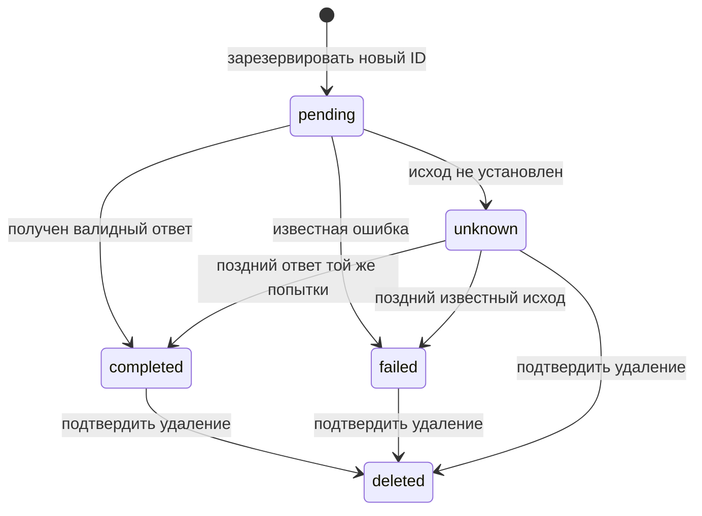

# Трекер входящих обращений и отвлечений

Продуктовая и техническая спецификация 1.3. Дата: 16 ноября 2026 года.

Это самостоятельная актуальная спецификация для реализации. Она учитывает исходный диалог, план 1.0, ревью 1.1 и 1.2 и последующие замечания. Предыдущие файлы сохраняются отдельно. Для реализации используются правила этого документа; исторические комментарии не являются дополнительными требованиями.

## 1. Решение в нескольких предложениях

Личное веб-приложение для одного пользователя на нескольких устройствах. Нажатие «Отвлекли» сразу фиксирует начало обращения. «Завершить» фиксирует окончание. Источник, тип и причину участия можно выбрать кнопками или дописать позже. Отдельный режим позволяет быстро записать уже закончившееся обращение.

Frontend и API публикуются одним Cloudflare Worker. Записи хранятся в одной D1. Доступ закрыт Cloudflare Access на конкретный email владельца. Телефон и компьютер читают общую базу; пока экран открыт, обновления запрашиваются каждые 15 секунд.

Статистика рассчитывается обычным кодом. Разбор дня и недели через LLM запускается вручную, работает с ключом владельца и сохраняется в D1. Основной поставщик: OpenRouter. Дополнительный вариант: API с совместимым Chat Completions-протоколом.

Один идентификатор запроса анализа разрешает приложению отправить не больше одного внешнего запроса к модели. Ошибка или истечение времени не запускают его повторно. Новый платный запуск требует нового явного действия пользователя.

Первая версия включает весь описанный ниже объём, в том числе дневной и недельный разбор.

## 2. Проблема и критерии полезности

Приложение помогает различить:

- необходимую управленческую нагрузку;
- вопросы, которые можно передать на другой уровень или устранить изменением процесса;
- дробление дня частыми переключениями;
- изначально завышенный план самостоятельной работы.

Обращение сотрудника не считается потерянным временем автоматически. Категории описывают наблюдаемое действие и оценку пользователя, а не характер или мотивацию другого человека.

Единица учёта: одно обращение или один эпизод самостоятельного отвлечения. Повторный заход по тому же вопросу создаёт отдельную запись. Приложение не склеивает записи и не ищет дубли по смыслу.

Короткие эпизоды тоже можно записывать. Минимального порога в пять минут нет.

Продукт считается удобным, если пользователь может:

1. Начать обращение одним касанием без клавиатуры.
2. Завершить его одним касанием.
3. Отметить частый источник и тип, не ожидая завершения сетевого запроса.
4. Записать прошедшее обращение примерно за три касания без обязательного текста.
5. Начать на компьютере и завершить с телефона.
6. Восстановить приблизительную картину вечером, если не получилось записывать в момент.

Цель локального отклика: около 100 мс на обычном устройстве. Это ориентир приёмки, а не обещание реакции быстрее одного кадра при любых условиях.

## 3. Границы первой версии

| Включено | Не включено |
| --- | --- |
| Живой таймер и запись прошедшего | Полный учёт всех 24 часов |
| Исправление начала, окончания и метаданных | Планировщик задач и проектов |
| Последние источники и закреплённые действия | CRM сотрудников, командные роли |
| Общая база для устройств | Отдельный сервис синхронизации, WebSocket |
| Локальное сохранение незавершённого ввода | Полная офлайн-работа с очередью множества записей |
| Дневная и недельная статистика | Автоматическое распознавание отвлечений |
| Необязательный контекст дня | Календарные и мессенджерные интеграции |
| LLM-разбор и история отчётов | Автономный агент, меняющий журнал |
| JSON/CSV-выгрузка | Импорт, слияние истории, автоматическая нормализация имён |
| Удаление выбранного объекта с подтверждением | Массовая очистка, автоудаление, корзина |
| Ярлык на домашнем экране телефона | Нативные приложения, обязательный Service Worker |
| Один активный таймер | Пауза и возобновление одного интервала |

Часовой пояс по умолчанию: Europe/Moscow. В настройках можно выбрать другую IANA-зону. Отчёты сохраняют пояс, в котором были сформированы.

## 4. Экраны и основные действия

### 4.1. «Сегодня»

Первый экран после входа. Сверху: дата, состояние сохранения и связи. Основная область:

- «Отвлекли», когда активного обращения нет;
- длительность и «Завершить», когда обращение идёт;
- «Завершить и начать новое» для смены одного обращения другим;
- закреплённые действия, например «Глеб · согласование», «Руководство · вопрос», «Сам отвлёкся»;
- «Записать прошедшее».

Ниже: количество начавшихся обращений, сумма длительностей завершённых записей за день, записи, которые можно дополнить. Активный интервал показывается отдельно.

Журнал выводится от новых записей к старым. Строка: время, источник, тип, длительность, короткая заметка. Нажатие открывает редактирование. Незаполненные значения видны как «Не указано».

Активное обращение видно и после смены раздела, в том числе если началось вчера. Клавиатура при старте сама не открывается. После завершения обязательной анкеты нет.

### 4.2. «Журнал»

Выбор дня или периода, фильтры по источнику и типу, поиск по заметке. Есть «Загрузить ещё». Из прошлого дня можно добавить запись на выбранную дату.

Кнопка живого старта всегда относится к реальному текущему моменту. Просмотр вчерашнего журнала не превращает её во вчерашний старт. Уже открытый черновик не меняет время при навигации.

### 4.3. «Разбор»

Переключатель «День / Неделя», период, числовая сводка, полнота данных, кнопка «Разобрать» и готовые отчёты. Статистика находится выше текста модели.

У отчёта показаны дата и время снимка, модель, замечания к полноте и свежести, стоимость при наличии данных от API. Технический номер редакции в обычном интерфейсе не показывается.

### 4.4. «Настройки»

Часовой пояс, закреплённые действия, необязательное описание рабочей роли, поставщик LLM, base URL, модель, наличие ключа, проверка модели и выгрузка.

Ключ вводится через Cloudflare Worker Secrets. В интерфейсе есть инструкция и признак наличия секрета, но нет сохранения ключа в браузере.

На телефоне используются крупные элементы не меньше 44 × 44 CSS-пикселей и форма снизу экрана. Не нужны серии достижений, оценки продуктивности и обязательные анимации.

## 5. Запись и поля

### 5.1. Живое обращение

В 11:42:07 пользователь нажимает «Отвлекли». Момент нажатия фиксируется до сети и выбора деталей. Клиент создаёт UUID и показывает «Сохраняю».

Пока старт сохраняется, можно выбрать источник и тип или нажать «Завершить». Изменения остаются привязаны к UUID этой записи. После подтверждения создания они отправляются в правильном порядке.

В 11:49:18 пользователь нажимает «Завершить». Окончание фиксируется сразу, даже если предыдущий запрос ещё не завершился. Ожидание сети не увеличивает длительность.

Источник и тип выбираются чипами с сохранением после выбора. Свободный текст редактируется с явной кнопкой «Сохранить». Неизвестные источник и тип не препятствуют сохранению.

### 5.2. Поля

| Поле | Правило |
| --- | --- |
| Кто / откуда | Необязательный текст до 80 символов |
| Тип | Согласование, проблема, координация, сделать руками, сам отвлёкся, другое; допустимо «Не указано» |
| Заметка | Необязательный текст до 500 символов |
| Начало | Подставляется в момент нажатия либо вводится вручную |
| Окончание | Пусто у активной записи; обязательно у завершённой |
| Почему именно я | Необязательная причина участия |
| Время приблизительное | По умолчанию да для ручного ввода, нет для таймера |

Причины участия: нужны мои полномочия; у сотрудника нет полномочий; не хватает знаний или опыта; нет назначенного ответственного; решение передали мне; не знаю / другое.

Это пользовательские оценки конкретных случаев. По ним нельзя автоматически делать вывод о нежелании человека брать ответственность.

Источник выбирается из последних значений или вводится текстом. Пробелы по краям убираются. Разные написания не объединяются автоматически. Закреплённое действие содержит подпись, источник и тип.

### 5.3. Новое обращение вместо текущего

На всех устройствах может быть только одна активная запись.

«Завершить и начать новое» закрывает конкретную ожидаемую запись и создаёт новую в одной транзакции. Один момент переключения становится окончанием старой и началом новой. Если ожидаемая запись или её редакция изменились, новая запись не создаётся.

UUID новой записи известен до отправки. Повтор того же запроса проверяет результат по этому UUID и не переключает таймер повторно.

### 5.4. Забытый таймер

После двух часов или перехода через полночь появляется «Ещё идёт?» с действиями «Завершить сейчас» и «Указать окончание». Оба признака могут действовать одновременно. Они вычисляются из времени и не хранятся отдельными статусами.

Приложение не останавливает таймер само и не обрезает длительность.

## 6. Прошедшее обращение и связанные поля времени

«Записать прошедшее» фиксирует окончание в момент открытия формы. Надпись содержит конкретное время: «Закончилось: 12:20». Пока форма открыта, это значение не продолжает двигаться.

Чипы «2 / 5 / 10 / 15 / 30 мин» задают длительность. Начало рассчитывается от выбранного окончания. «Закончилось 5 минут назад» отсчитывается от момента открытия формы, а не от времени последующего сохранения.

Есть два явных якоря:

| Состояние формы | Изменение длительности | Изменение начала | Изменение окончания |
| --- | --- | --- | --- |
| Окончание закреплено, режим по умолчанию | Окончание остаётся, двигается начало | Окончание остаётся, считается длительность; якорь становится началом | Задаётся новое окончание, длительность сохраняется, двигается начало |
| Начало закреплено после ручной правки начала | Начало остаётся, двигается окончание | Длительность сохраняется, двигается окончание | Начало остаётся, считается длительность |

В форме есть понятное действие «Считать от окончания / Считать от начала», если пользователь хочет сменить якорь. Это небольшой переключатель рядом с полями времени, а не обязательный шаг.

Пример: форма открыта в 12:00. После выбора пяти минут получаются 11:55–12:00. Замена длительности на десять минут, кнопкой или вручную, даёт 11:50–12:00.

В базе хранятся только начало и окончание. Длительность является вычисляемой величиной. Форму обновляет одна функция по событию пользователя, а не несколько взаимно запускающихся эффектов.

Можно выбрать прошлую дату и перейти через полночь. Конец раньше начала и завершённый интервал в будущем запрещены. При несуществующем локальном времени из-за смены часового пояса требуется исправление; при неоднозначном времени пользователь выбирает один из двух UTC-сдвигов.

Ручное окончание не исправляется сервером молча.

## 7. Часы устройств и календарь

Все моменты хранятся как UTC-миллисекунды. Даты и границы дней рассчитываются в выбранной IANA-зоне.

Клиент получает `server_now` и оценивает разницу часов с учётом времени запроса. При заметном расхождении от минуты показывает предупреждение. Оценка не является точной синхронизацией часов.

При наличии свежей калибровки живой момент нажатия определяется по серверному временному якорю и монотонным часам текущей вкладки. После возвращения из фонового режима калибровка обновляется. Без неё используется время устройства с отметкой приблизительности. Уже зафиксированное нажатие при повторной отправке не пересчитывается.

Для небольшого остаточного рассинхрона при живом завершении допустима ограниченная поправка: если окончание раньше начала не более чем на две секунды, сервер ставит окончание равным началу, отмечает время приблизительным и возвращает `time_adjusted: true`. Большая разница вызывает понятную ошибку с сохранением черновика и возможностью указать время.

При переключении вычисляется один `effective_switch_at`. Если нужна такая поправка, это значение используется и для окончания старой, и для начала новой записи. Нельзя исправить только одну сторону.

Эта поправка предотвращает отрицательный интервал; она не восстанавливает точную длительность. Для ручного ввода она не применяется.

Для календарных операций используется Temporal через `@js-temporal/polyfill`, для отображения можно использовать `Intl`. Следующий локальный день определяется календарным прибавлением дня, а не прибавлением 86 400 000 миллисекунд. Длительность календарных суток не ограничивается константой 24 или 25 часов.

## 8. Контекст дня

У дня есть необязательные поля:

| Поле | Смысл |
| --- | --- |
| Планировал на свои задачи, мин | Оценка желаемой самостоятельной работы |
| Было доступно после известных встреч и рутины, мин | Исходный бюджет на эту работу |
| Что получилось | Заметка о результатах, решениях и разблокированной работе |
| Полнота журнала | Не оценивал / записал часть / внёс всё, что помню |

Это не отдельный планировщик задач. Поля не мешают пользоваться таймером.

Если план равен 300 минутам, а исходно доступно 180, приложение показывает перегруз плана на 120 минут. Из доступного времени не вычитаются автоматически все записанные обращения: неизвестно, какие уже учтены во встречах и рутине.

Числа неотрицательны и не превышают фактическую длительность соответствующего календарного дня. Смена часового пояса не переносит заметку на другую дату. Полнота является оценкой пользователя и не запрещает дальнейшие исправления.

## 9. Статистика без LLM

Для дня и недели считаются:

- начавшиеся обращения, включая текущую активную запись;
- сумма длительностей завершённых интервалов внутри периода;
- медиана длительности целых завершённых обращений, начавшихся в периоде;
- количество и время по источникам, типам и причинам участия;
- обращения короче пяти минут, распределение начала по часам;
- незаполненные поля и доля приблизительных измерений;
- дни с записями и пользовательская оценка полноты;
- незавершённое обращение отдельным блоком.

Неделя идёт с понедельника по воскресенье. Выходные не считаются автоматически пропусками. Сравнение недель сопровождается количеством дней с данными и оценкой полноты.

Пустой неподтверждённый день показывает «Нет записей». Ноль обращений можно показать как подтверждённый только при соответствующей отметке пользователя. Если есть продолжение вчерашнего интервала, день не считается пустым даже при нуле начавшихся обращений.

Активный таймер не входит в сумму завершённых затрат.

Интервалы трактуются как `[начало, окончание)`. Пересечение есть тогда и только тогда, когда:

```text
max(start_a, start_b) < min(end_a, end_b)
```

Произвольного порога в 60 секунд нет. Интервалы 11:00–11:30 и 11:30–12:00 не пересекаются. Ручные пересечения допускаются и помечаются, без удаления или склейки записей.

Временная сумма называется «Сумма длительностей записей». Она не выдаётся за уникально занятое время и не используется для утверждения «занятость 143%».

Интервал через полночь остаётся одной записью. Для сумм он обрезается границами каждого дня. Интервал 23:50–00:10 даёт по десять минут двум дням, количество начавшихся обращений учитывается один раз.

Нулевая длительность допустима и считается в количестве. Суммы округляются после сложения.

По пробелам журнала нельзя определить сфокусированную работу, прокрастинацию, простои или стоимость возвращения внимания. Такие показатели не придумываются.

Статистика и вход LLM строятся по всему выбранному периоду независимо от пагинации журнала. Первые 500 строк интерфейса не должны превращаться в ограничение статистики.


## 10. Техническая архитектура

Один репозиторий, один Worker, одна D1, один адрес. Статические файлы интерфейса и API имеют общий origin.

| Часть | Выбор |
| --- | --- |
| Frontend | React + TypeScript + Vite |
| Оформление | Обычный CSS |
| API | TypeScript + Hono |
| Контракты и валидация | Общие Zod-схемы |
| База | Cloudflare D1, прямой параметризованный SQL |
| Доступ | Cloudflare Access и проверка JWT в API |
| Календарь | Temporal через @js-temporal/polyfill |
| LLM | Серверный fetch, один активный поставщик |
| Разработка | Wrangler и локальная D1 |
| Проверки реализации | Vitest и несколько Playwright-сценариев |

Не нужны ORM, отдельный backend, KV, R2, Redis, Durable Objects, очереди и агентный фреймворк.

В конфигурации Static Assets API выполняется раньше SPA fallback: `assets.run_worker_first = ["/api/*"]`. Неизвестный API-путь возвращает JSON 404, а не HTML приложения.

Каталоги: `src/web`, `src/worker`, `src/shared`, `migrations`, `tests`. Версии зависимостей фиксируются lockfile при реализации.

## 11. Доступ и ошибки сети

Cloudflare Access защищает весь Worker: основной адрес, preview и дополнительные имена. Разрешён один email владельца. Вход: одноразовый код на почту или настроенный поставщик идентификации.

API дополнительно проверяет JWT: подпись по доверенному JWKS, ожидаемые issuer и audience, срок действия и email владельца. Одного наличия заголовка или email недостаточно. JWKS кешируется на уровне экземпляра Worker.

Все браузерные запросы API используют `redirect: "manual"`. Для API не предусмотрены прикладные HTTP-редиректы. Поэтому `opaqueredirect` обрабатывается как необходимость восстановить сессию. Сам адрес редиректа браузер в таком ответе не раскрывает.

401 и явно распознанная ошибка истёкшей сессии ведут ко входу. Обычный 403 означает «Доступ запрещён», а не бесконечное предложение войти заново. Ошибка сетевого транспорта сохраняет ввод и показывает «Не удалось связаться с приложением»; она сама по себе не доказывает отсутствие интернета.

Сессия восстанавливается переходом верхнего уровня, после которого черновик восстанавливается. Фоновый fetch не пытается пройти процедуру входа.

Локальный обход проверки допустим только в среде локального Wrangler с локальной D1. Production не получает разрешающий обходной флаг. При отсутствии параметров проверки API закрыт.

## 12. Сохранение, быстрые клики и локальный черновик

### 12.1. Один поток изменения конкретной записи

У клиента есть подтверждённая сервером запись и отдельный локальный ввод, привязанный к её UUID. На одну запись одновременно выполняется не больше одного запроса изменения.

Пока запрос в полёте, новые значения чипов объединяются в последний локальный патч. Они не порождают параллельные PATCH с одинаковой редакцией.

Подтверждение удаляет из буфера только отправленные значения, которые действительно подтверждены. Более новый выбор того же поля остаётся в буфере.

| Момент | Что доступно |
| --- | --- |
| Сохраняется первоначальный старт | Выбор чипов, однократное нажатие «Завершить» с фиксацией времени |
| Сохраняется патч активной записи | Новые чипы, однократное завершение или переключение |
| Зафиксирована команда завершения | Повтор команды заблокирован; старый интервал больше не редактируется чипами |
| Выполняется переключение | Повтор переключения и следующая переходная команда заблокированы; уточнения новой записи остаются привязаны к её UUID |
| Есть неразрешённый сетевой исход или конфликт | Предлагается восстановить текущую операцию; скрытая очередь новых обращений не накапливается |

Если «Завершить» нажато раньше ответа на создание, сначала подтверждается создание, затем отправляется завершение с исходным временем нажатия и последними метаданными.

Если уже выполняется PATCH, завершение ждёт его ответа и использует актуальную редакцию. Финальные метаданные разрешено передать вместе с завершением. Для переключения аналогично передаётся патч закрываемой записи.

Эта последовательность не должна переносить время нажатия на момент отправки последнего запроса.

### 12.2. Что сохраняется локально

Один незавершённый пользовательский ввод, а не журнал всех операций: вид команды, UUID цели и при необходимости новой записи, исходные времена, базовая редакция, отправленный неизменяемый payload, более новые поля и выбранный раздел/дата формы.

Может сохраняться текущий снимок незавершённой отправки и более новый ввод той же операции. Это не очередь независимых обращений.

Черновик записывается до отправки. Ответ сервера или фоновое обновление его не затирают. У вкладки есть tab_id в sessionStorage, а ключ localStorage включает tab_id и версию формата черновика. После перезагрузки восстанавливается собственный ввод; новая вкладка может предложить выбрать найденный несохранённый черновик. Вкладки не перезаписывают один общий localStorage-ключ. Старый неизвестный формат не удаляется автоматически.

Отдельно сохраняется только указатель на текущий запрос анализа: его UUID и период. Это указатель для проверки результата, а не офлайн-очередь платных запросов.

### 12.3. Восстановление зависит от команды

| Исход | Правило |
| --- | --- |
| Создание: UUID найден | Использовать существующую запись; сравнить и сохранить неподтверждённые метаданные |
| Создание: UUID не найден | Показать черновик и ручное действие повторной отправки с тем же UUID |
| Изменение/завершение существующей записи: UUID не найден | Конфликт «Запись отсутствует»; не создавать её заново |
| Запись уже завершена | Разрешить состояние таймера, но отдельно проверить оставшиеся поля; не очищать их по одному признаку ended_at |
| Переключение: новая запись найдена | Переключение состоялось; не переключать повторно, проверить метаданные новой записи |
| Переключение: новой записи нет, старая изменилась | Показать конфликт; не завершать другой активный таймер |
| Подтверждённое удаление: объект отсутствует | Удаление разрешено считать завершённым |

Если после неизвестного исхода текущее значение поля совпадает с желаемым локальным, это поле можно считать восстановленным. Различающиеся поля остаются в черновике и требуют решения пользователя. Совпадение одного поля не подтверждает остальные.

При 409 на старте серверная активная запись и черновик несостоявшегося старта остаются разными объектами. Автоматически переносить чипы или команду завершения на чужой UUID запрещено.

Конфликт показывает серверные значения и собственный ввод с действиями «Сохранить мои изменения» и «Оставить серверные». Первый вариант использует новую ожидаемую редакцию после явного выбора. Сброс неподтверждённого ввода требует подтверждения.

Полной офлайн-работы нет. Неотправленная операция явно помечается, на другом устройстве она не считается сохранённой.

## 13. Чтение, синхронизация и версии

Обновление выполняется при открытии, возвращении на вкладку, после изменения и каждые 15 секунд на видимом экране. В фоне опрос останавливается. Личные ответы имеют `Cache-Control: no-store`.

`data_revision` является общим счётчиком содержательных пользовательских изменений: записей, контекста дня и несекретных настроек. Он увеличивается в той же транзакции, что изменение. Создание, завершение и удаление отчётов счётчик не увеличивают.

У отдельных редактируемых строк есть собственная `revision`. Она нужна для конфликта редактирования, а не для отбора старых снимков.

Снимок дня и его data_revision читаются одной согласованной D1 batch-транзакцией. Ответ изменения содержит запись, итог операции и соответствующий этой транзакции data_revision.

Клиент принимает ответ чтения только если одновременно выполнены условия:

1. Совпадает текущий ключ запроса: раздел, дата/период, часовой пояс и фильтры.
2. Это последняя актуальная загрузка этого ключа; идентификатор загрузки не устарел.
3. data_revision не меньше уже увиденной клиентом.
4. После старта чтения не произошла локальная операция, делающая этот ответ устаревшим.
5. Незавершённая форма остаётся отдельным слоем и не заменяется полученными строками.

Смена даты или фильтра делает предыдущие загрузки неактуальными. AbortController экономит запросы, но корректность обеспечивается проверкой ответа.

Начальная загрузка получает настройки, затем запрашивает день с явным часовым поясом. Если пояс в настройках изменился на другом устройстве, сервер возвращает TIMEZONE_CHANGED с актуальными настройками; клиент перестраивает запрос. Нельзя показывать данные, рассчитанные в другом поясе, под старой подписью.

Журнал сортируется по `started_at DESC, id DESC`. Значения limit: по умолчанию 500, максимум 2000. Курсор содержит пару `started_at, id` последней строки и связан с исходными фильтрами и периодом. Ответ содержит `next_cursor` и `has_more`. Для следующей страницы используется строгое условие после этой пары. При изменении данных уже загруженный список можно обновить с первой страницы.

## 14. Модель данных и SQL-инварианты

Четыре таблицы. Пользователи и организации не моделируются.

### 14.1. Новая база

Ниже минимальная схема для новой установки. Ограничения длины строк, перечисления причин и прикладные проверки времени дополнительно задаются общими Zod-схемами.

```sql
-- V13_SCHEMA
CREATE TABLE settings (
  id INTEGER PRIMARY KEY CHECK (id = 1),
  timezone TEXT NOT NULL DEFAULT 'Europe/Moscow',
  pinned_actions_json TEXT NOT NULL DEFAULT '[]',
  analysis_context TEXT NOT NULL DEFAULT '',
  llm_provider TEXT NOT NULL DEFAULT 'openrouter',
  llm_base_url TEXT NOT NULL DEFAULT 'https://openrouter.ai/api/v1',
  llm_model TEXT,
  revision INTEGER NOT NULL DEFAULT 1 CHECK (revision >= 1),
  data_revision INTEGER NOT NULL DEFAULT 0 CHECK (data_revision >= 0)
);
INSERT INTO settings (id) VALUES (1);

CREATE TABLE entries (
  id TEXT PRIMARY KEY NOT NULL,
  started_at INTEGER NOT NULL,
  ended_at INTEGER,
  source_name TEXT,
  kind TEXT NOT NULL DEFAULT 'unknown',
  note TEXT,
  why_me TEXT,
  capture_mode TEXT NOT NULL CHECK (capture_mode IN ('timer', 'manual')),
  time_estimated INTEGER NOT NULL CHECK (time_estimated IN (0, 1)),
  created_at INTEGER NOT NULL,
  updated_at INTEGER NOT NULL,
  revision INTEGER NOT NULL DEFAULT 1 CHECK (revision >= 1),
  CHECK (ended_at IS NULL OR ended_at >= started_at)
);
CREATE UNIQUE INDEX entries_single_active_v13
  ON entries ((1)) WHERE ended_at IS NULL;
CREATE INDEX entries_started ON entries (started_at, id);
CREATE INDEX entries_source ON entries (source_name);
CREATE INDEX entries_kind ON entries (kind);

CREATE TABLE day_notes (
  date TEXT PRIMARY KEY NOT NULL,
  planned_minutes INTEGER CHECK (planned_minutes IS NULL OR planned_minutes >= 0),
  available_minutes INTEGER CHECK (available_minutes IS NULL OR available_minutes >= 0),
  outcomes_note TEXT,
  coverage TEXT NOT NULL DEFAULT 'unknown'
    CHECK (coverage IN ('unknown', 'partial', 'full')),
  updated_at INTEGER NOT NULL,
  revision INTEGER NOT NULL DEFAULT 1 CHECK (revision >= 1)
);

CREATE TABLE reports (
  id TEXT PRIMARY KEY NOT NULL,
  kind TEXT NOT NULL CHECK (kind IN ('day', 'week', 'connection_test')),
  status TEXT NOT NULL DEFAULT 'pending'
    CHECK (status IN ('pending', 'completed', 'failed', 'unknown', 'deleted')),
  date_from TEXT,
  date_to_exclusive TEXT,
  timezone TEXT,
  created_at INTEGER NOT NULL,
  updated_at INTEGER NOT NULL,
  completed_at INTEGER,
  input_revision INTEGER,
  provider TEXT NOT NULL,
  model TEXT NOT NULL,
  prompt_version TEXT NOT NULL,
  input_snapshot_json TEXT,
  result_json TEXT,
  error_code TEXT,
  input_tokens INTEGER,
  output_tokens INTEGER,
  cost REAL,
  deleted_at INTEGER,
  CHECK (kind = 'connection_test'
    OR (date_from IS NOT NULL AND date_to_exclusive IS NOT NULL AND timezone IS NOT NULL)),
  CHECK (status != 'completed' OR result_json IS NOT NULL),
  CHECK ((status = 'deleted' AND deleted_at IS NOT NULL)
    OR (status != 'deleted' AND deleted_at IS NULL))
);
CREATE INDEX reports_period ON reports (kind, date_from, created_at);
```

UUID отчёта одновременно является ключом запроса. Отдельный составной idempotency_key из периода, редакции и случайной строки не требуется.

Состояние обращения выводится из окончания. Длительность не хранится. Отдельный статус «таймер идёт» в entries не нужен.

У settings есть собственная revision для формы настроек: очередное обращение не делает её устаревшей. Счётчик data_revision при изменении обращения увеличивается без изменения settings.revision.

### 14.2. Условное переключение

Переключение выполняется в одном D1 batch. Первый UPDATE проверяет конкретные id, revision и отсутствие окончания. Последующие изменения зависят от успеха предыдущего DML. Между этими шагами нельзя вставлять посторонний изменяющий запрос.

Минимальный проверяемый шаблон без метаданных:

```sql
-- V13_SWITCH
UPDATE entries
SET ended_at = :switch_at,
    updated_at = :now,
    revision = revision + 1
WHERE id = :old_id
  AND revision = :expected_revision
  AND ended_at IS NULL;

INSERT INTO entries (
  id, started_at, ended_at, capture_mode, time_estimated, created_at, updated_at
)
SELECT :new_id, :switch_at, NULL, 'timer', :estimated, :now, :now
WHERE changes() = 1;

UPDATE settings
SET data_revision = data_revision + 1
WHERE id = 1 AND changes() = 1;
```

В реализации первый шаг также сохраняет финальный патч старой записи, а INSERT включает метаданные новой. Один effective_switch_at передаётся в оба шага.

Ожидаемый результат: 1/1/1 изменённых строк при успехе или 0/0/0 при несовпадении предусловия. SQL-ошибка откатывает batch. После batch читаются сохранённые строки и редакция в этой же транзакции для ответа.

Если повторный запрос проиграл уже завершившемуся такому же switch, сервер проверяет new_id: найденный результат возвращается без изменений. Иначе несовпадение даёт 409. Проверка существования до batch полезна, но сама по себе не является защитой от гонки.

PATCH не может вернуть завершённую запись в активную. У активной записи окончание задаётся командами finish/switch. У завершённой записи можно исправить оба времени, оставив окончание непустым.

Finish проверяет ожидаемую редакцию. Если запись уже завершена, возвращает её с исходом already_finished и не переносит окончание. Неподтверждённые метаданные клиента при этом не считаются автоматически применёнными.

### 14.3. Миграции

Для новой установки: 0001_init.sql. Уже применённые миграции не редактируются; следующие изменения получают новые порядковые номера.

Если реальная база создана по 1.1, одно CREATE INDEX IF NOT EXISTS с прежним именем ошибочный индекс не исправит. Новый корректный индекс entries_single_active_v13 создаётся под новым именем. Старый не требуется удалять для исправления гарантии.

Если в базе уже несколько активных записей, миграция останавливается и показывает проблему. Она не выбирает запись для закрытия и не удаляет данные самостоятельно.

Схема существующей установки сначала проверяется. Расширение старых CHECK-ограничений reports и преобразование старых отчётов требуют отдельной миграции под фактическую схему; универсальный слепой upgrade не обещается. Старые готовые отчёты не должны становиться pending.

Разрушающие операции, восстановление базы и удаление объектов выполняются только после отдельного разрешения владельца. В этой задаче никакие миграции к реальной базе не применяются.


## 15. LLM-разбор дня и недели

### 15.1. Подключение

Основной вариант: OpenRouter, Chat Completions API. Дополнительный: OpenAI-compatible endpoint с тем же форматом запроса и ответа. Совместимость с другим протоколом требует отдельного адаптера; универсальная поддержка любого API не обещается.

Один активный ключ хранится в секрете Worker LLM_API_KEY. Несекретные настройки: поставщик, HTTPS base URL, model ID, необязательное описание рабочей роли. Endpoint меняет только владелец. Внешний fetch не следует редиректам с ключом.

При смене поставщика владелец при необходимости меняет секрет. Интерфейс не получает ключ, экспорт его не содержит. Ключи не хранятся в localStorage или таблицах.

OpenCode Go ориентирован на coding agents, поэтому не является гарантированной интеграцией для анализа журнала. Другой сервис подключается после проверки его протокола и пригодности для этого сценария.

### 15.2. Один ID, одна попытка внешнего вызова

UUID report_id создаётся один раз на явное нажатие и сохраняется до отправки. Повтор HTTP-запроса использует тот же UUID и тот же период. Дата, input_revision и случайный суффикс не собираются заново при каждом сетевом повторе.

Сервер:

1. Проверяет доступ, параметры периода и наличие подключения.
2. Проверяет, существует ли report_id. Если существует, возвращает его состояние без внешнего вызова.
3. Для нового ID получает согласованный снимок источника, настройки модели и готовые числовые метрики.
4. Создаёт строку reports со status=pending, параметрами и снимком до обращения к модели.
5. Только обработчик, который действительно вставил новую строку, получает право выполнить fetch.
6. Один раз обращается к модели и сохраняет результат или исход ошибки.

Вставка резервирует первичный ключ. Проверки SELECT перед INSERT недостаточно: при одновременных запросах право вызова определяется результатом INSERT ... ON CONFLICT(id) DO NOTHING. Проигравший обработчик читает существующую строку.

Тот же ID, переданный с другим периодом или видом запроса, получает ID_REUSE_CONFLICT. Параметры существующего запроса не переписываются.

### 15.3. Состояния запроса

| Состояние | Значение | Повтор с тем же ID |
| --- | --- | --- |
| pending | Попытка зарезервирована, результата пока нет | Вернуть состояние, не вызывать модель |
| completed | Получен и проверен результат | Вернуть результат |
| failed | Известная ошибка, включая некорректный JSON после ответа | Вернуть ошибку, не вызывать модель |
| unknown | Исход не установлен: обрыв, таймаут, зависшая попытка | Вернуть неопределённый исход, не вызывать модель |
| deleted | Отчёт удалён пользователем | Вернуть 410, не вызывать модель |



Внешний запрос ограничен 60 секундами. Pending старше 90 секунд показывается как unknown и может быть переведён в это состояние условным обновлением. Это не разрешение перезапустить запрос.

Из failed, unknown и deleted нет перехода обратно в pending для того же ID. «Запустить новый анализ» создаёт новый UUID и является новым внешним запросом. При неопределённом исходе рядом указано, что предыдущая попытка могла быть оплачена. Дополнительного модального согласования оплаты нет.

Ошибка валидации ответа не запускает повторную генерацию или скрытое «исправление JSON» через LLM.

Если ответ завершившейся первоначальной попытки пришёл позднее, обновить можно только соответствующий pending/unknown. Готовый результат, чужая новая попытка и deleted не перезаписываются.

Гарантия относится к вызовам, инициируемым приложением для сохранённого ID. Это не обещание возврата денег или особенностей списания на стороне поставщика.

### 15.4. Неизвестный исход и несколько устройств

После обрыва или перезагрузки клиент читает GET /api/reports/:id. Для pending экран периодически проверяет этот ID, пока видим; первоначально раз в две секунды. По завершении или unknown опрос прекращается. Другие записи журнала работают независимо.

Если ID не найден, показывается «Запуск не подтверждён» с ручной повторной отправкой того же ID. Если первый обработчик ещё работает, уникальная резервация всё равно допускает только одного отправителя.

Список готовых отчётов показывает только completed с kind=day/week. Текущий pending/failed/unknown виден отдельной карточкой состояния, а не исчезает как будто запроса не было.

Закрытие страницы не сопровождается обещанием обязательного фонового завершения. Очередь, Cron и отдельный worker обработки не нужны.

Проверка модели использует тот же механизм резервации с kind=connection_test и отдельным UUID. Она не передаёт журнал, запрашивает короткое «OK», ограничивает ответ примерно 16 токенами и явно обозначена как запрос к модели. Технический повтор теста тоже не вызывает второй fetch для того же ID.

### 15.5. Вход и результат

Числа считаются по всему периоду. Передаются метрики, оценка полноты, контекст дня, выбранные записи с ID и короткий контекст роли.

Начальный лимит подготовленного входа: 24 000 символов. Для отчёта запрашивается до 2 000 выходных токенов в пределах возможностей модели. Точный расход берётся из ответа API.

Если все тексты не помещаются, метрики всё равно используют все записи. Сервер отбирает ограниченные примеры по длительности, повторяемости источника/типа и времени. В снимке сохраняются общее число записей и число примеров. Отчёт не выдаёт выборку за анализ всех текстов.

При полном отсутствии записей и содержательного контекста платный вызов не выполняется. Небольшой набор данных допустим с явным ограничением выводов.

Форма результата:

| Поле | Требование |
| --- | --- |
| Короткий вывод | 2–4 предложения |
| Наблюдения | Не больше трёх, со ссылками на ID метрик и записей |
| Необходимое участие | Какие обращения выглядят соответствующими роли |
| Гипотезы изменений | Полномочия, знания, ответственность, порядок обращений |
| Ограничения | Что установить нельзя |
| Следующий эксперимент | Одно действие, ожидаемый эффект и способ проверки |

Модель не получает инструментов изменения данных. Заметки трактуются как данные, а не команды. Запрещены выдуманные причины поведения людей, оценки лени и автоматическое объявление обращений потерями.

JSON Schema режим используется только при поддержке моделью. Иначе формат задаётся инструкцией и проверяется тем же валидатором. Проверяются существование ссылок именно в переданном снимке, структура и ограничения длины. Значения метрик для интерфейса подставляет код. Свободный текст не считается автоматически доказанным.

Небольшой пример ожидаемого вывода на вымышленных данных:

> Четыре обращения относятся к случаям, где ты указал отсутствие полномочий у сотрудника. На неделю можно передать право решать один повторяющийся класс вопросов в заданных пределах и проверить изменение частоты таких обращений.

### 15.6. Снимок, свежесть и расходы

Отчёт сохраняет входной снимок, его data_revision, часовой пояс, время подготовки, модель и prompt_version. Изменение журнала не переписывает старый текст.

Признаки показываются независимо:

- «После анализа данные или настройки менялись», если текущая data_revision отличается.
- «Срез сделан до окончания периода», если при подготовке день/неделя ещё шли.
- Полнота данных на момент анализа.

Срез, сделанный в обед, не превращается автоматически в итог дня после полуночи. Для итога требуется новый явный запуск. Изменение другого дня или настройки тоже может вызвать консервативную отметку свежести; она не означает, что вывод обязательно неверен.

LLM не пересчитывает статистику. Недоступность модели, отсутствие ключа, неверная модель, лимит средств и ошибка ответа не мешают учёту.

Токены и стоимость сохраняются, если API их вернул. Cost нормализуется в USD только когда такая валюта явно известна; иначе стоимость неизвестна. Ошибочный JSON мог быть оплачен, поэтому его usage по возможности тоже сохраняется.

Показ ошибок содержит безопасный код, HTTP-статус поставщика, request ID при наличии и очищенное сообщение. Полные запросы, ключи и заметки не отправляются в логи и не выводятся из сырого тела ошибки.

## 16. Удаление и выгрузка

### 16.1. Подтверждение

Для записи или отчёта показываются дата, короткое описание и последствия. «Отмена» ничего не меняет. До подтверждения DELETE не отправляется. При изменении объекта на другом устройстве подтверждение пересматривается по актуальному состоянию.

Запись удаляется из entries. Отчёты, построенные раньше, остаются снимками: удаление строки журнала не очищает их текст автоматически. Для удаления содержимого отчёта используется отдельное подтверждённое действие.

Pending-отчёт не удаляется как готовый объект; сначала нужно дождаться исхода или его перехода в unknown.

### 16.2. ID удалённого отчёта

Удаление отчёта очищает input_snapshot_json, result_json и текстовое содержимое ошибки. Статус становится deleted, ставится deleted_at. Минимальная техническая строка с UUID и метаданными попытки остаётся.

Это необходимо, чтобы поздний повтор старого HTTP-запроса не создал новый платный вызов после удаления результата. GET такого отчёта возвращает 410. Поздний ответ модели не восстанавливает удалённое содержимое.

Отдельной таблицы удалений, корзины и фоновой очистки нет.

### 16.3. Экспорт

JSON содержит schema_version, версию приложения, дату выгрузки, несекретные настройки, обращения, контекст дней и отчёты с их состояниями. API-ключи и JWT не экспортируются.

CSV содержит журнал с русскими заголовками. Текстовые поля с опасными формульными префиксами нейтрализуются до CSV-кодирования; обычное экранирование кавычек само по себе недостаточно. Исходные строки в базе и JSON не меняются.

Экспорт большого набора читает данные страницами или потоково и не наследует лимит одной страницы журнала. Ошибка скачивания не меняет базу. Импорта в первой версии нет.

Постраничная выгрузка является копией прочитанных строк, а не гарантированным снимком всей базы в один момент. В метаданных JSON указываются начало и окончание выгрузки и это ограничение. Проверка data_revision до и после может обнаружить изменения журнала и настроек, но не доказывает неизменность отчётов: у них собственные updated_at. Для точной резервной копии используется штатная операция D1 при обслуживании.

D1 Time Travel дополняет ручной экспорт. Восстановление базы не запускается автоматически.


## 17. API

Все маршруты защищены. Время передаётся UTC-миллисекундами, календарные параметры содержат явный часовой пояс. Секреты не возвращаются.

| Метод и путь | Контракт |
| --- | --- |
| GET /api/settings | Несекретные настройки, settings.revision, data_revision, has_key |
| PATCH /api/settings | Разрешённые поля и expected_revision; нельзя записать счётчики или секрет |
| GET /api/snapshot?date=...&timezone=... | query_key, settings, entries дня, day_note или null, глобальный active_entry, data_revision, server_now |
| GET /api/entries?from=...&to=...&timezone=...&limit=...&cursor=... | Фильтры source/kind/q; entries, next_cursor, has_more, data_revision, query_key |
| GET /api/entries/:id | Текущая конкретная запись |
| POST /api/entries | id от клиента, режим, времена, метаданные; существующий UUID не изменяется |
| PATCH /api/entries/:id | Только явно изменённые поля и expected_revision |
| POST /api/entries/:id/finish | expected_revision, clicked_ended_at, необязательный финальный патч; повтор не меняет окончание |
| POST /api/entries/switch | expected_id, expected_revision, switch_at, new_entry_id, closing_patch, preset новой записи |
| DELETE /api/entries/:id | expected_revision после подтверждения |
| GET /api/day-notes/:date | Контекст дня или null |
| PUT /api/day-notes/:date | Поля и expected_revision; 0 означает создание при отсутствии строки |
| GET /api/stats?kind=day_or_week&date=...&timezone=... | Все метрики периода, полнота, замечания и data_revision |
| POST /api/reports | report_id, kind=day/week, date, timezone; резервирует одну попытку |
| GET /api/reports/:id | pending/completed/failed/unknown; deleted возвращает 410 |
| GET /api/reports?kind=...&date=...&cursor=... | Готовые отчёты периода; страницы по created_at/id, 20 по умолчанию, максимум 100 |
| DELETE /api/reports/:id | Ожидаемые status и updated_at после подтверждения; очистка содержимого и сохранение UUID |
| POST /api/llm/test | report_id, тот же механизм одной попытки, kind=connection_test |
| GET /api/export?format=json_or_csv | Выгрузка без секретов; не ограничивается страницей журнала |

Для истории даты задают календарный период с исключённым правым краем. Журнал включает пересекающие его интервалы и нулевые события внутри периода. Периоды для LLM ограничены одним днём или календарной неделей.

Успешный ответ изменения обращения содержит entry или old_entry/new_entry, operation_result, data_revision и при необходимости time_adjusted. Примеры operation_result: applied, existing, already_finished. Только applied подтверждает отправленный патч; existing/already_finished требуют сверки оставшихся полей.

POST анализа возвращает готовое состояние при завершении обработки или 202 с report_id/status, если такой ID уже выполняется. Для существующих failed/unknown возвращается их состояние. Клиент не преобразует такой ответ в новый запуск.

Ошибка имеет форму:

```json
{
  "error": {
    "code": "ENTRY_CHANGED",
    "message": "Запись изменена на другом устройстве"
  },
  "data_revision": 42
}
```

При конфликте, если применимо, дополнительно передаются current_entry или active_entry с полной фактической записью. data_revision добавляется, когда она известна обработчику.

Основные коды: AUTH_REQUIRED (401), ACCESS_DENIED (403), NOT_FOUND (404), ENTRY_CHANGED / ACTIVE_ENTRY_EXISTS / TIMEZONE_CHANGED / ID_REUSE_CONFLICT (409), REPORT_DELETED (410), INVALID_INTERVAL / TIME_REVIEW_REQUIRED (422).

Проверка ожидаемой редакции выполняется внутри изменяющего SQL, а не отдельным SELECT до записи. Для создания day_notes два одновременных INSERT не перезаписывают друг друга: проигравший получает актуальную строку и конфликт.

## 18. Состояния и важные переходы

Это области поведения приложения. Не каждая производная подпись требует отдельного хранимого автомата или класса.

| Область | Состояния или признаки | Основной инвариант |
| --- | --- | --- |
| Доступ | checking, allowed, login_required, denied | Запрет доступа отличается от истёкшего входа |
| Связь | reachable, unreachable, reconnecting | Ошибка не удаляет ввод; состояние интернета не угадывается по одному fetch |
| Часы | calibrated, estimated, skew_warning | Повтор не меняет уже захваченный момент |
| Загрузка раздела | loading, ready, failed + query_key/request_id | Ответ другого дня или фильтра не применяется |
| Жизненный цикл обращения | running, completed | Определяется ended_at; обратно в running не переходит |
| Локальное сохранение | clean, sending, sending_with_new_input, recovering, conflict | Одна мутация на цель; подтверждаются только соответствующие значения |
| Управление таймером | idle, starting, running, stopping, switching, recovering | Команда привязана к конкретному UUID и редакции |
| Ручная форма | end_anchor, start_anchor | Из двух времён выводится третья величина |
| Черновик | empty, dirty, submitting, recovery_needed, conflict_held | Завершённость серверной записи не очищает неподтверждённые поля |
| Редактирование журнала | viewing, editing, saving, conflict, failed | Опрос не заменяет открытую форму |
| Удаление | closed, confirming, deleting, failed | Нет DELETE без подтверждения |
| Полнота дня | unknown, partial, full + наличие записей | Пустота не приравнивается к отсутствию отвлечений |
| Возраст таймера | crossed_midnight и over_two_hours | Независимые вычисляемые признаки без автоостановки |
| Настройка LLM | missing, ready_to_test, testing, available, failed | Наличие ключа не доказывает работоспособность модели |
| Запрос LLM | pending, completed, failed, unknown, deleted | Нет повторного внешнего вызова для того же ID |
| Отображение отчёта | версия источника, полнота, период был открыт | Готовность ответа не означает полноту рабочего дня |
| Выгрузка | idle, exporting, downloaded, failed | Ошибка не меняет данные |

Переходы, которые обязательно покрываются реализацией:

| Событие | Результат |
| --- | --- |
| Завершение во время starting | Сохранить время команды; после создания завершить тот же UUID |
| Ещё один чип во время PATCH | Оставить последнее значение в буфере; отправить после ответа с новой revision |
| 409 на старте | Показать серверную активную запись; сохранить отдельный черновик без переноса его полей |
| 409 на PATCH | Сохранить ввод и показать конфликт; не перебазировать изменения молча |
| Обрыв finish | Прочитать цель; разрешить состояние таймера отдельно от метаданных |
| Серверная цель уже завершена, локальные поля не совпали | Таймер завершён, черновик полей сохранён |
| 404 на существовавшую цель PATCH | Не превращать PATCH в создание |
| Старый GET после смены даты | Отбросить даже при той же data_revision |
| failed/unknown отчёт с тем же ID | Вернуть состояние, не генерировать заново |
| Поздний ответ после удаления отчёта | Не восстановить содержимое |

## 19. Работа с данными и обслуживание

Личные данные не помещаются в публичный HTML или общедоступный кеш. Service Worker с кешем журнала не добавляется.

Текст модели отображается как текст или безопасный Markdown без произвольного HTML. Внешний контент не выполняет команды. Логи содержат только технические коды, безопасные идентификаторы и параметры длительности.

Запросы изменения проверяют origin и JSON-формат. CORS не разрешает произвольные сайты. Доступные владельцу настройки не заменяют проверку доступа на сервере.

Настройка, вход и просмотр с ярлыка домашнего экрана iPhone проверяются на реальном устройстве. Если поведение авторизации отличается от обычного Safari, это фиксируется как ограничение и исправляется до заявления о поддержке.

Обновления приложения не пересоздают базу. Dev/test используют локальную или отдельную D1, без проверочных строк в личном production-журнале. Production и preview закрыты и проверяются незалогиненным клиентом.

## 20. Стоимость и ограничения

Предполагается бесплатный личный контур Cloudflare. Проверенные на 16.11.2026 ориентиры:

| Сервис | Бесплатный объём |
| --- | --- |
| Workers | 100 000 динамических запросов в день, 10 мс CPU на запрос |
| Static Assets | Бесплатные запросы в штатном режиме выдачи статики |
| D1 | 5 млн прочитанных строк и 100 тыс. записанных строк в день, 5 ГБ суммарного хранения по аккаунту; отдельные лимиты одной базы |
| Access | До 50 пользователей |
| Адрес | Поддомен workers.dev |
| LLM | Отдельные условия и тариф выбранного API |

Два видимых устройства по девять часов с опросом раз в 15 секунд дают около 4 320 запросов в день плюс действия пользователя. Читается выбранный день, а не вся история.

Ожидание сети не является CPU-временем Worker. Тем не менее JWT, JSON, календарная библиотека и обработка больших наборов проверяются на реальном Free-плане. Нельзя гарантировать бесплатность только по числу HTTP-запросов.

Целевой хостинг может стоить $0 в пределах квот. LLM может требовать оплаты. Приложение не обещает фиксированную цену неизвестной модели.

## 21. Реализация и приёмка

### 21.1. Порядок

| Этап | Результат |
| --- | --- |
| 1. Основа | Репозиторий, Worker + Static Assets, D1, Access, проверка JWT, общие схемы |
| 2. Ввод | Старт, завершение, прошедшие записи, якорь времени, быстрые чипы |
| 3. Надёжность устройств | Последовательное сохранение, черновики, конфликты, ключи загрузок, глобальный таймер |
| 4. Сводка | Контекст дня, пагинация журнала, полные метрики, качество данных |
| 5. LLM | Резервация одной попытки, дневной и недельный разбор, ошибки, удаление отчёта |
| 6. Публикация | Миграции, настройки и секрет, закрытый адрес, приёмка двух устройств |

Ни один из этапов не означает публикацию без выполнения последующих обязательных проверок. LLM-разбор входит в эту же первую версию.

### 21.2. Обязательные сценарии

| Проверка | Ожидаемый результат |
| --- | --- |
| Старт без полей | Запись создана, клавиатура не открылась |
| Детали выбраны через 30 секунд | Время начала осталось временем первого нажатия |
| Старт, два чипа и завершение за 500 мс | Последние поля и время нажатий сохранены, собственных конфликтов нет |
| Чип изменён повторно во время отправки | Ответ предыдущего запроса не стирает более новый выбор |
| Finish нажат до ответа создания | Завершён именно создаваемый UUID |
| Обновление/закрытие страницы | Серверный таймер и локальный неподтверждённый ввод восстанавливаются раздельно |
| Начать на компьютере, завершить на телефоне | Один интервал, корректная обработка часов |
| Одновременный старт | Только одна активная строка; проигравший черновик не переносится на другую |
| Второй активный INSERT напрямую | Уникальный индекс отклоняет его |
| Switch со старой revision при отсутствии активных строк | Новая запись не создаётся, счётчик не увеличивается |
| Сбой второй команды switch | Старое окончание откатывается |
| Повтор switch с тем же new_entry_id | Нового переключения нет |
| Повтор finish | Исходное окончание не меняется |
| Поздний GET после мутации | Более старые данные не заменяют новые |
| Поздний GET за другую дату с равной revision | Ответ отвергается |
| Редактирование с двух устройств | Конфликт виден, собственный ввод остаётся |
| GET восстановления нашёл завершённую цель | Неподтверждённые поля не очищены |
| PATCH-цель удалена на другом устройстве | Нет автоматического создания |
| Прошедшее: пять минут заменены десятью | Конец закреплён, начало сдвинуто назад |
| Интервал 23:50–00:10 | По десять минут двум дням, одно начало |
| Стык 11:00–11:30 / 11:30–12:00 | Пересечения нет |
| Пересечение на 30 секунд | Пометка есть |
| День со сменой UTC-сдвига | Реальные границы дня, без константы 24/25 часов |
| Корректировка switch из-за часов | Старый конец равен новому началу |
| Пустой неподтверждённый день | «Нет записей» |
| Нулевой счётчик начал, но есть перенос вчерашнего | День не объявлен пустым |
| История больше лимита страницы | Есть следующая страница; статистика включает все записи |
| Нет ключа / модель недоступна | Учёт и числовая сводка работают |
| Повтор анализа во время pending | Один внешний вызов |
| Повтор после failed, включая некорректный JSON | С тем же ID второго вызова нет |
| Pending старше 90 секунд | Unknown, без повторного вызова |
| Обрыв после принятия запроса поставщиком | Не обещается отсутствие оплаты; повтор не отправляется автоматически |
| Явный новый анализ после unknown | Новый ID, новый осознанный вызов |
| Удалённый отчёт запрошен старым POST | 410, нового вызова нет |
| Поздний ответ на удалённый отчёт | Содержимое не восстанавливается |
| Дневной отчёт сделан до конца дня | На следующий день не становится итоговым сам |
| Изменение журнала во время анализа | Отчёт хранит исходный снимок и отмечает изменение версии |
| Истечение Access в fetch | Предложение восстановить вход, ввод сохранён |
| Настоящий запрет доступа | Denied, без цикла входа |
| Незалогиненный запрос production/preview | Личные данные недоступны |
| Bundle, settings API, экспорт и логи | Значений ключей и JWT нет |
| Отмена удаления | Ничего не удалено |
| JSON/CSV-выгрузка | Все выбранные строки доступны, секретов и исполняемых формул нет |
| Обновление версии | История и активный таймер сохранены |

Автоматические проверки реализации покрывают математику времени, SQL-инварианты, переходы сохранения, конфликт редакций и один внешний вызов на report_id. Сквозные проверки используют два браузерных контекста и подмену LLM, не расходуя реальные ключи.

На реальных телефоне и компьютере проверяются скорость фиксации, вход, возврат на вкладку, плохая связь и отсутствие потерянного ввода.

## 22. Что изменено относительно 1.2

1. Убраны противоречащие друг другу исторические указания из актуального текста; прошлые документы сохранены отдельно.
2. Один report_id не запускается повторно после ошибки, таймаута, старения pending или удаления результата.
3. Добавлен unknown; незавершённость не приравнивается к бесплатному неисполненному запросу.
4. Восстановление подтверждает отдельные поля и команды, а не удаляет весь черновик по ended_at.
5. Буферы привязаны к UUID и не переезжают на другую запись при 409.
6. Ответ чтения проверяется по дате, поясу, фильтрам, загрузке и редакции.
7. У прошедшего обращения по умолчанию закреплено окончание.
8. Пересечения определяются строго математически, без минутного порога.
9. Исправление часов использует общий момент switch и не выдаётся за восстановление точной длительности.
10. Дана рабочая пагинация; статистика не ограничена страницей.
11. Исправление старого индекса учитывает IF NOT EXISTS и не требует удаления старого объекта.
12. Состояние 403, сырой текст ошибок, предварительный отчёт и потоковый экспорт имеют явные границы.
13. Проверка модели тоже использует одну зарезервированную попытку.

## 23. Основание и технические источники

Источники требований:

- [Исходная расшифровка](https://chatgpt.com/library?file_id=libfile_368b900d11c88191877f3de5eefc4d38&account_id=personal).
- [План 1.0](https://chatgpt.com/library?file_id=libfile_1616b909ca5c8191b1f10ebbe99a09de&account_id=personal).
- [Ревью 1.1](https://chatgpt.com/library?file_id=libfile_0f7047fee6d08191a764e616701d4a64&account_id=personal).
- [Ревью 1.2](https://chatgpt.com/library?file_id=libfile_76e7bb9260788191b30a864bf3b7a472&account_id=personal).
- Последующие замечания в текущем диалоге.

Технические ориентиры:

- [D1 batch и транзакции](https://developers.cloudflare.com/d1/worker-api/d1-database/#batch).
- [SQLite CREATE INDEX и IF NOT EXISTS](https://www.sqlite.org/lang_createindex.html).
- [SQLite changes()](https://www.sqlite.org/lang_corefunc.html#changes).
- [Workers Static Assets](https://developers.cloudflare.com/workers/static-assets/).
- [Cloudflare Access для Workers](https://developers.cloudflare.com/workers/configuration/cloudflare-access/).
- [Проверка JWT Access](https://developers.cloudflare.com/cloudflare-one/access-controls/applications/http-apps/authorization-cookie/validating-json/).
- [Fetch Response.type](https://developer.mozilla.org/en-US/docs/Web/API/Response/type).
- [Temporal и часовые пояса](https://tc39.es/proposal-temporal/docs/zoneddatetime.html).
- [OpenRouter API](https://openrouter.ai/docs/api/reference/overview).
- [OpenCode Go](https://opencode.ai/docs/go/).
- [Workers pricing](https://developers.cloudflare.com/workers/platform/pricing/), [D1 pricing](https://developers.cloudflare.com/d1/platform/pricing/), [Access pricing](https://www.cloudflare.com/plans/zero-trust-services/).

Документация и тарифы уточняются при реализации, если изменились после даты этой спецификации.

## 24. Результат и пределы готовности

Получится один закрытый адрес с быстрым журналом обращений, общей базой устройств, исправлением прошлых записей и разбором дня/недели. Записывать можно в момент или приблизительно позже. Числа доступны без LLM.

Версия 1.3 является планом реализации. Создание документа и проверка SQL-примеров не означают, что приложение, авторизация, работа между устройствами или production-деплой уже реализованы и прошли приёмку.

При подготовке документа SQL из раздела 14 выполнен в SQLite 3.53.1. Проверены запрет второй активной строки, успешный switch, отказ при старой редакции и уже завершённой цели, откат при ошибке INSERT, создание корректного индекса рядом со старым ошибочным, сохранение одной резервации report_id при разных исходах и запрет восстановления удалённого отчёта поздним результатом. Проверки прошли. Файлы предыдущих версий остались неизменными.

Эти проверки подтверждают SQL-шаблоны и описанные условия. Приёмка реального D1, браузерных переходов, сети, Access, часов и внешнего LLM API остаётся обязательной частью реализации.
